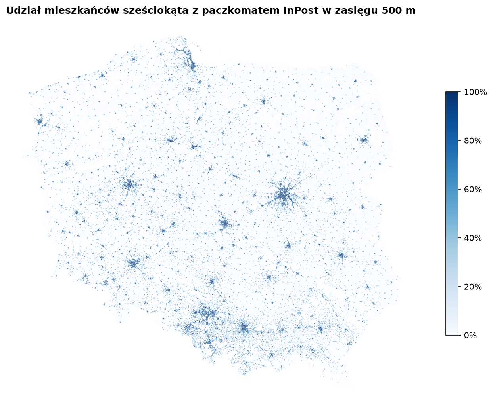

# Zasięg paczkomatów w Polsce

Ilu mieszkańców ma paczkomat w zasięgu krótkiego spaceru, gdzie są białe plamy i gdzie warto postawić kolejny automat.
Projekt łączy publiczną mapę punktów InPost, siatkę ludności Kontur (sześciokąty H3) i automaty innych operatorów
z OpenStreetMap.

Projekt niezależny, niezwiązany z InPost ani innymi operatorami.

## Najważniejsze liczby (stan sieci z 24.10.2026)

| | |
|---|---|
| Mieszkańcy z paczkomatem InPost w zasięgu 500 m | **46,4%** |
| w zasięgu 1 km | 69,6% |
| mieszkańcy, którzy mają do paczkomatu ponad 1 km | 11,3 mln |
| miasta (gęstość > 2000 os./km²) w zasięgu 500 m | 85,3% |
| wieś i przedmieścia (50–500 os./km², 35,5% ludności) w zasięgu 500 m | 14,8% |
| najlepsze / najsłabsze województwo | śląskie 57% / świętokrzyskie 31% |
| powiaty z zasięgiem 500 m poniżej 20% | 58 z 380 |
| działające paczkomaty / w budowie | 32 702 / 920 |

- **Białe plamy to wieś i przedmieścia**: tam mieszka ponad jedna trzecia ludności, a tylko co siódma osoba ma paczkomat w 500 m.
- **Dostęp to prawie wyłącznie kwestia urbanizacji**: korelacja zasięgu 500 m w powiecie z udziałem mieszkańców miast
  wynosi 0,96. Ciekawsze od rankingu są więc powiaty poniżej poziomu podobnie zurbanizowanych (strona „Regiony”).
- **InPost zagęszcza sieć**: 70,8% sześciokątów z paczkomatami w budowie ma już działający paczkomat.
- **Konkurencja stoi obok InPost**: tylko 7,3% automatów innych operatorów z OpenStreetMap (9 739 automatów) stoi
  w sześciokątach bez paczkomatu InPost.

Odległość liczona w linii prostej od środka sześciokąta H3 (rozdzielczość 9, bok ok. 175 m) do najbliższego
działającego paczkomatu.

**Ludność skalibrowana do GUS.** Kontur daje w sumie 41,1 mln mieszkańców (GUS: 37,3 mln), a w 12 miastach
(np. Elbląg, Włocławek, Suwałki) umieszcza dużą część mieszkańców poza granicą miasta, w sąsiednim powiecie ziemskim.
Wykryłem to po nierealnej liczbie paczkomatów na mieszkańca (Włocławek: 56 na 10 tys. przy medianie 7,5). Dlatego liczbę
mieszkańców każdego powiatu biorę z Banku Danych Lokalnych GUS (2025), a Kontur tylko rozkłada ją w powiecie.
24 powiaty z niepewnym rozkładem (te miasta i powiaty wokół nich) są oznaczone i pominięte w porównaniach.



## Co jest w repo

| | |
|---|---|
| `src/paczkomaty/` | pobieranie danych (API InPost, Kontur, Overpass) z ponawianiem, pokrycie ludności, agregaty na sześciokąt |
| `notebooks/01_eksploracja` | jakość danych, kluczowe liczby, mapy statyczne |
| `app/` | aplikacja Streamlit z interaktywną mapą (pydeck, warstwa H3) |
| `src/paczkomaty/zrzut.py`, `historia.py` | codzienny zrzut sieci i historia zmian (nowe, usunięte, zmiana statusu) |
| `src/paczkomaty/granice.py`, `gus.py`, `hurtownia.py` | przypisanie sześciokątów do powiatów, ludność z GUS, budowa hurtowni |
| `dbt/` | hurtownia (DuckDB): sześciokąty, powiaty, województwa, testy jakości danych |
| `powerbi/dane/` | tabele dla Power BI (Parquet) |
| `.github/workflows/` | testy przy każdym pushu, codzienny zrzut sieci |
| `tests/` | testy jednostkowe (pytest) |

## Uruchomienie

```bash
uv sync
uv run jupytext --to notebook --execute notebooks/01_eksploracja.py   # pobiera dane i zapisuje agregaty
uv run python -m paczkomaty.zrzut        # stan sieci dzisiaj
uv run python -m paczkomaty.hurtownia    # regiony, GUS, dbt build, eksport
uv run streamlit run app/app.py
uv run pytest
```

Surowe dane trafiają do `data/` (poza repozytorium). Aplikacja czyta tylko agregaty z hurtowni (`data/agregaty`):
liczbę paczkomatów i ludność na sześciokąt i powiat, bez pojedynczych punktów.

## Hurtownia i testy jakości danych

dbt + DuckDB: `staging` (cienkie widoki na pliki Parquet) i `marts` (`heksagony`, `powiaty`, `wojewodztwa`).
37 testów, m.in.: 380 powiatów i 16 województw, suma ludności po kalibracji równa GUS, agregacja nie gubi ludzi,
udziały w przedziale 0–1, liczba paczkomatów policzona ze współrzędnych zgodna z polem „województwo” z API
(różnica poniżej 0,2% w każdym województwie).

## Historia sieci

Od 24.10.2026 workflow `zrzut` codziennie zapisuje stan sieci i porównuje go z poprzednim dniem. Publiczne są tylko
agregaty (wydanie `dane`): `stan_dzienny.parquet` (liczba paczkomatów wg województwa i statusu) i
`zmiany_dzienne.parquet` (liczba nowych, usuniętych i zmian statusu wg województwa). Jeśli API zwróci wyraźnie mniej
punktów niż dzień wcześniej (poniżej 95%), zrzut jest odrzucany, żeby awaria nie wyglądała jak zamknięcie paczkomatów.

## Dalej

Model zapotrzebowania (LightGBM z walidacją przestrzenną), wybór nowych lokalizacji maksymalizujący pokrycie
i porównanie rekomendacji z paczkomatami, które są właśnie w budowie.

## Źródła danych

- Publiczna mapa punktów InPost (`api-pl-points.easypack24.net`), dane prezentowane wyłącznie w agregacji.
- [Kontur Population: Poland](https://data.humdata.org/dataset/kontur-population-poland), licencja CC BY 4.0.
- [Bank Danych Lokalnych GUS](https://bdl.stat.gov.pl): ludność powiatów (zmienna 72305, 2025).
- Granice powiatów i województw: PRG GUGiK, w formacie GeoJSON z
  [ppatrzyk/polska-geojson](https://github.com/ppatrzyk/polska-geojson) (MIT).
- © współtwórcy [OpenStreetMap](https://www.openstreetmap.org/copyright), licencja ODbL. Dane o automatach
  innych operatorów są niepełne, więc liczby konkurencji to dolna granica.
