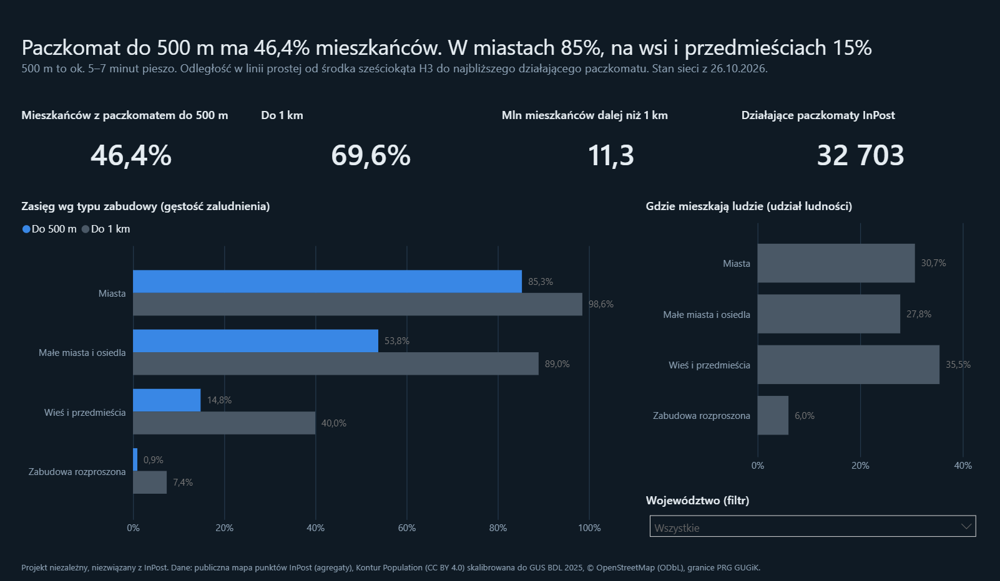

# Raport Power BI: Zasięg paczkomatów

Ta sama historia co aplikacja, w formie raportu biznesowego: przegląd, regiony z mapą powiatów, urbanizacja,
model zapotrzebowania i historia sieci.



## Otwarcie

1. Power BI Desktop (Microsoft Store), język pliku: polski (**Plik → Opcje → Ustawienia regionalne**),
   żeby liczby miały spację tysięcy i przecinek dziesiętny.
2. Otwórz `raport/zasieg_paczkomatow.pbip` (projekt Power BI: model i strony zapisane jako pliki tekstowe,
   więc zmiany widać w gicie).
3. **Narzędzia główne → Odśwież**. Przy pierwszym odświeżeniu Power BI zapyta o dostęp do
   `raw.githubusercontent.com`: wybierz **Anonimowy → Połącz**. Dane pobierają się z tego repozytorium
   (`powerbi/dane/*.parquet`), więc raport działa na każdym komputerze bez kopiowania plików.

Praca bez internetu: **Przekształć dane → Edytuj parametry → Folder** i wpisz ścieżkę do folderu `powerbi\dane\`
w swoim klonie (z ukośnikiem na końcu). Zapytania same rozpoznają, czy to adres, czy ścieżka.

| plik | co to |
|---|---|
| `raport/zasieg_paczkomatow.pbip` | gotowy raport (model TMDL + strony) |
| `dane/powiaty.parquet` | 380 powiatów: ludność (GUS), zasięg 500 m / 1 km, paczkomaty, udział mieszkańców miast, `dane_niepewne` |
| `dane/wojewodztwa.parquet` | 16 województw: to samo + liczba paczkomatów według pola z API (kontrola) |
| `dane/zabudowa.parquet` | mieszkańcy i zasięg wg województwa i typu zabudowy (z kolumną `kolejnosc` do sortowania) |
| `dane/powiaty_model.parquet` | model: paczkomaty faktyczne i przewidywane w powiecie (356 powiatów, bez niepewnych) |
| `dane/stan_dzienny.parquet` | liczba paczkomatów wg dnia, województwa i statusu (od 24.10.2026) |
| `mapa/powiaty.topojson` | granice powiatów do mapy kształtów (klucz: `nazwa`); ta sama mapa jest wbudowana w raport |
| `miary.dax` | wszystkie miary i kolumny obliczeniowe z komentarzami (to samo, co jest w modelu) |
| `motyw_ciemny.json`, `motyw_jasny.json` | motywy zgodne z aplikacją (raport ma wbudowany ciemny) |

## Model

```
powiaty_model (*) ──── (1) powiaty (*) ──── (1) wojewodztwa (1) ──── (*) zabudowa
      [powiat_id]           [powiat_id]           [wojewodztwo]          [wojewodztwo]
                                                       (1)
                                                        │
                                                       (*) stan_dzienny [wojewodztwo]
```

- Relacje wiele do jednego, filtrowanie w jedną stronę. `wojewodztwa` to wspólny wymiar: fragmentator województwa
  filtruje powiaty, zabudowę i historię naraz.
- W Power Query: `powiaty_model[powiat_id]` → liczba całkowita (w pliku jest dziesiętna), `stan_dzienny[data]` → data.
- W `stan_dzienny` są 3 paczkomaty w budowie bez województwa (`nieznane`): pod filtrem województwa znikają,
  w sumie dla kraju są.
- Miary są w tabeli `_Miary`, kolumny obliczeniowe (oczekiwany zasięg z regresji, klasa zasięgu) w `powiaty`.

**Liczby kontrolne** (bez filtrów): zasięg 500 m 46,4%, 1 km 69,6%, 11,3 mln mieszkańców dalej niż 1 km,
32 703 działające paczkomaty, 917 w budowie, 58 powiatów poniżej 20%, korelacja 0,96, miasta 85,3%,
wieś i przedmieścia 14,8%.

## Strony

| strona | co pokazuje |
|---|---|
| Przegląd | 4 karty (zasięg 500 m i 1 km, mieszkańcy dalej niż 1 km, paczkomaty), zasięg wg typu zabudowy, gdzie mieszkają ludzie, filtr województwa |
| Regiony | mapa kształtów powiatów (kolor: bursztynowy poniżej 20%, szary przy średniej kraju 46%, niebieski powyżej 70%), województwa, ranking powiatów, filtr województwa |
| Urbanizacja | wykres punktowy udział mieszkańców miast a zasięg, korelacja, powiaty poniżej oczekiwań (regresja, bez 24 niepewnych) |
| Model | paczkomaty faktyczne i według modelu, największe braki, wykres punktowy model a rzeczywistość |
| Historia sieci | działające paczkomaty i paczkomaty w budowie dzień po dniu (zapełnia się z każdym odświeżeniem danych) |

Mapa: wizualizacja **Mapa kształtów** z własnym plikiem TopoJSON. Działa bez Bing/Azure, które dopasowują powiaty
po nazwie z geokodera i mylą powiaty o tej samej nazwie (np. dwa grodziskie). Kolor ustawiony przez
**Kolory wypełnienia → fx → Gradient** na mierze `Zasięg 500 m`.

## Zasady

- **Tytuł = wniosek** z liczbą, nie etykieta.
- **Jedna oś Y** na wykresie; procenty i sztuki na osobnych wykresach.
- **Kolor = znaczenie**: niebieski dobry zasięg, bursztynowy braki, szary środek.
- **Średnie ważone ludnością**: zasięg województwa to suma mieszkańców w zasięgu przez sumę mieszkańców,
  nie średnia z powiatów.
- **Stopka źródeł** na każdej stronie.

## Odświeżanie danych

Na Macu `uv run python -m paczkomaty.pipeline`, potem eksport do `powerbi/dane/`, commit i push.
Raport po **Odśwież** pobiera nowe pliki z GitHuba. `.pbip` zmieniaj tylko na jednym komputerze naraz.
